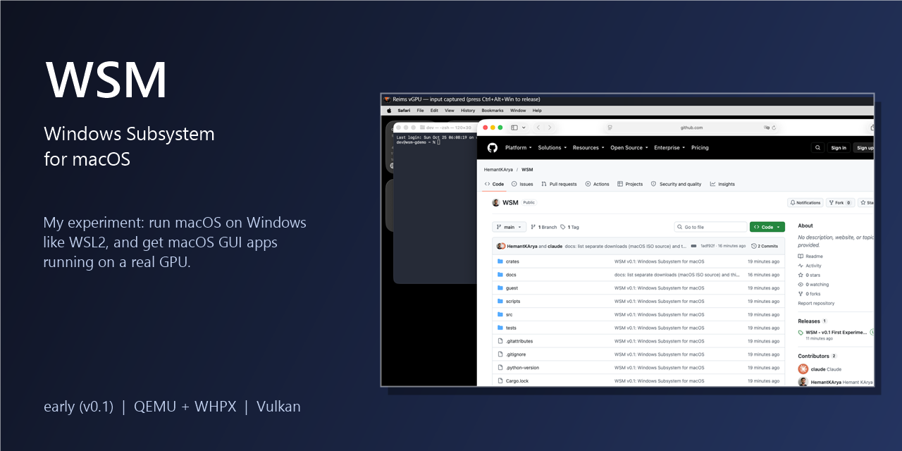
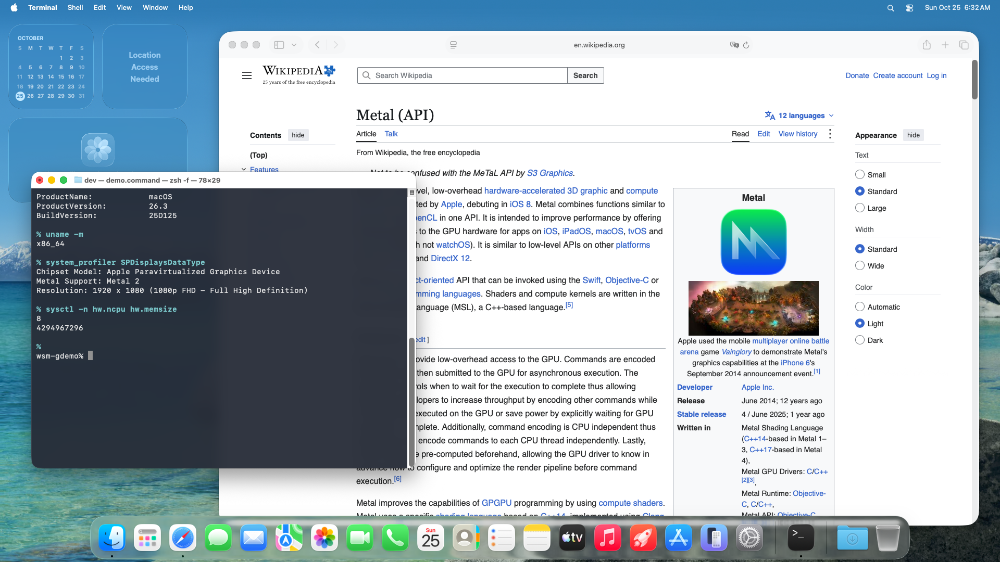

<p align="center">
  
</p>

<h1 align="center">Windows Subsystem for macOS</h1>

<p align="center">
  <a href="https://github.com/HemantKArya/WSM/releases">Releases</a> &middot;
  <a href="#see-it-run">Screenshots</a> &middot;
  <a href="docs/DEPENDENCIES.md">What to download</a> &middot;
  <a href="docs/ROADMAP.md">Roadmap</a> &middot;
  <a href="RESULTS.md">Measurements</a>
</p>

WSM is my experimental project to run macOS on Windows the way WSL2 runs Linux: type one command and you are in a
shell, stop it and the whole VM is saved to a file, run it again and you are back in about two seconds. No installer
wizard, no VM manager window, nothing added to Windows itself.

The second goal is macOS GUI software with a real GPU behind it. The aim is hardware-accelerated graphics through
Vulkan or Direct3D instead of a software framebuffer. Right now that works through Vulkan only (Metal calls are
translated by reims-vgpu), and the macOS desktop shows up in one window rather than app by app. Direct3D is not
done. It is early: v0.1, built and tested on one AMD laptop with an RTX 4050.

macOS Tahoe 26.3 on x86-64 is as new as Intel macOS gets, so that is what this targets. I don't ship any Apple
software. You bring your own installer and build a base image from it; the exact download and checksum are in
[docs/DEPENDENCIES.md](docs/DEPENDENCIES.md).

Acceptance status and every measured number: [RESULTS.md](RESULTS.md). More: [docs/WRITEUP.md](docs/WRITEUP.md) (summary),
[docs/ROADMAP.md](docs/ROADMAP.md) (known gaps and future work), [docs/AMD-OPENCORE-PATCHES.md](docs/AMD-OPENCORE-PATCHES.md),
[docs/DEPENDENCIES.md](docs/DEPENDENCIES.md) (downloads and third-party software), [docs/RELEASING.md](docs/RELEASING.md). The installable package (`wsm-setup.zip`) is a release asset, not in the repository.

## See it run

Light base, real session on one AMD 7840HS laptop (`docs/images/terminal-session.txt`, wall times include starting `wsm.exe`):

```
$ wsm --name demo create
wsm: generating this instance's OpenCore image
wsm: generating SSH key and config disk
created 'demo' (ssh port 59718)

$ wsm --name demo start
demo in 21.8s (cold)

$ wsm --name demo exec -- sw_vers
ProductName:		macOS
ProductVersion:		26.3
BuildVersion:		25D125

$ wsm --name demo exec --root -- id -u
0

$ wsm --name demo run --detach -- sleep 600
261025-130547-234 pid 240 log /Volumes/WSMData/Users/dev/.wsm/jobs/261025-130547-234/log

$ wsm --name demo jobs
261025-130547-234      running  pid 240    sleep 600

$ wsm --name demo stop        # suspend to a file
suspended: 2.2s, 1149 MB (migrate 2.2s, drain 0.0s, fsync 0.1s; QEMU exit 0.1s)

$ wsm --name demo start       # resume
demo in 2.3s (resume)

$ wsm --name demo jobs        # same job, still running
261025-130547-234      running  pid 240    sleep 600

$ wsm --name demo exec -- true   # warm exec, 10 runs
82 77 72 73 68 69 88 77 74 73 ms
```

GPU profile (`wsm create --gpu`, `wsm gui start`): macOS Tahoe 26.3 desktop in a host window, accelerated by reims-vgpu on Vulkan.
Safari shows this repository; the Terminal window is the guest's.

<p align="center"></p>

## How it works

```
wsm.exe  (CLI)  ── owner-only named pipe + JSON RPC ──  wsmd.exe (per-user background service)
                                                          ├─ QEMU + WHPX (Windows Hypervisor Platform)
                                                          │   ├─ QMP, serial console, suspend stream:
                                                          │   │  AF_UNIX socket files in the instance
                                                          │   │  directory (owner + SYSTEM only)
                                                          │   └─ SSH: 127.0.0.1:<port> → guest sshd (key only)
                                                          ├─ SSH connection pool (wsm exec)
                                                          └─ WebDAV bridge on 127.0.0.1 (wsm mount / wsm share)
```

- **Hypervisor:** QEMU with WHPX. One QEMU build: aljus7/reims-vgpu v0.3.0's QEMU plus six WSM
  patches (`src/patches/`), built by `src/build/build-qemu.sh`.
- **Instant start:** `wsm stop` saves the VM to `state.bin` (2 GiB guest: ~1.5 s) and the next `wsm`
  resumes it (~2 s to a shell). Guest time is frozen while saved and set from the host on resume.
  Instances idle for 15 minutes (no shell, exec or file access) are suspended automatically.
- **Cold boot** (no saved state) reaches SSH in ~24 s (core, 8 vCPU; the very first boot of a new instance adds ~15 s of provisioning). The serial console (`wsm shell --serial`) is a
  fallback that works without networking; macOS starts third-party boot services late, so it is not
  faster than SSH.
- **GPU profile** (`wsm create --gpu`): Apple's paravirtual GPU via reims-vgpu on Vulkan (tested:
  RTX 4050). The desktop session logs in hidden at boot so `wsm gui start` shows a warm desktop
  (measured 30-45 fps presented, see limits) in under two seconds once the session is up; `wsm gui stop` hides the window and keeps the session. GPU instances
  can't be suspended (the device blocks migration); `wsm stop` shuts them down.
- **Files:** keep projects inside the guest (fast APFS). `wsm cp` copies both ways. `wsm mount`
  maps the guest home to a drive letter with Windows' own WebDAV client (nothing to install).
  `wsm share C:\some\folder` makes a Windows folder available in the guest at `~/win/<name>`.

## Requirements

- Windows 11, x86-64 CPU (AMD or Intel), 16 GB RAM recommended, ~40 GB free disk.
- Windows features **Virtual Machine Platform** and **Windows Hypervisor Platform** enabled
  (`wsm doctor` checks; enabling them needs an administrator once).
- A macOS Tahoe 26.3 installer image (for `wsm base build` / `build-lite`), or a base image built from one.
  Download it yourself: <https://archive.org/download/mac-os-tahoe-26.3/macOS%20Tahoe%2026.3.iso>
  (sha256 `6737e096...d567`). WSM does not include it. Every other download, bundled component and
  build tool, with exact sources, is listed in [docs/DEPENDENCIES.md](docs/DEPENDENCIES.md).

No administrator rights are needed to run wsm.

## Install

The tool ZIP and the macOS base are separate files. Extract `wsm-setup.zip` to a staging folder, then:

```powershell
.\install.ps1                                   # -> %LOCALAPPDATA%\wsm, adds it to your user PATH
# or fully portable (nothing outside the folder, no PATH change):
.\install.ps1 -Root D:\tools\wsm -NoPath
```

A packaged `wsm.exe` uses the folder it is in as its home, so a portable copy is self-contained.
Then get a base image, either one built elsewhere or built locally:

```powershell
wsm base import D:\images\base-tahoe-26.3-XXXXXXXXXXXX.qcow2   # needs its .sha256 sidecar or --sha256
wsm base build --iso "D:\images\macOS Tahoe 26.3.iso"          # ~1-2 h, unattended
wsm create            # instance "default"
wsm                   # shell
```

`wsm uninstall --yes` removes the runtime folder, its PATH entry and the per-user GPU preference;
`--portable` leaves Windows settings alone.

## Commands

| command | does |
|---|---|
| `wsm` / `wsm shell [--serial\|--ssh]` | start or resume the instance and attach a shell |
| `wsm exec [--root] -- cmd args` | run a command; stdin/stdout/stderr streamed, exit code returned; `--root` runs as root (lite base) |
| `wsm run --detach -- cmd args` / `wsm jobs` / `wsm kill ID` | background job that outlives the SSH session (log in `~/.wsm/jobs/ID/log`) |
| `wsm start [--cold]` / `wsm stop [--shutdown\|--kill]` | resume or cold boot / suspend (default) |
| `wsm list`, `wsm status`, `wsm logs [--file serial-timed.log]` | |
| `wsm cp SRC DST [-r]` | copy; guest paths start with `:` |
| `wsm mount [W:]` / `wsm unmount [W:]` | guest home as a Windows drive (WebDAV) |
| `wsm share DIR [--as NAME]` / `wsm unshare NAME` | Windows folder in the guest at `~/win/NAME` |
| `wsm gui start\|stop\|logout\|status` | desktop window of a GPU instance |
| `wsm create [--gpu] [--ram MiB] [--vcpus N]` / `wsm delete` | instances (overlays on a read-only base) |
| `wsm base build\|build-lite\|import\|export\|list` | make or move a base image (`lite-data BASE --extras PACK` rebuilds only a lite base's tools-pack template) |
| `wsm doctor [--fix]` | host checks; `--fix` sets the per-user GPU preference for QEMU |

All instance commands take `--name N` (default `default`). Only one GPU instance runs at a time.

## Security notes

- The serial console is a passwordless login for the instance owner. It is reachable only through
  a socket file whose ACL is the owner and SYSTEM; QMP and the suspend stream use the same protection.
- SSH is key-only; the key is generated per instance and readable only by the owner.
- `wsm mount`/`wsm share` listen on 127.0.0.1 only and serve only paths under a random 128-bit token.
- The base image contains no user, keys, host keys or machine identity; each instance generates its
  own at first boot. SIP stays enabled. The base grants remote-login (SSH) sessions full disk access,
  the documented Sharing option, so `wsm exec` can use ~/Documents, ~/Desktop and network volumes.

## Building from source (dev workspace)

Everything is portable under `tools\` (MSYS2, rustup, 7-Zip, QEMU build deps); nothing is installed
system-wide. With `WSM_HOME` pointing at a dev runtime:

```
cargo build --release                        # wsm.exe, wsmd.exe (Rust workspace, crates/)
cargo clippy --release --all-targets -- -D warnings ; cargo test --release
src/build/build-qemu.sh SRC_DIR OUT_DIR       # QEMU + reims-vgpu with the patches (MSYS2 bash)
tests/p3_generic.py                           # two fresh instances, identities, export/import
tests/p6_acceptance.py INSTANCE               # timing/dev/resource suite (drives wsm.exe only)
tests/p6_gpu.py GPU_INSTANCE --anim BIN       # Metal readback, first-session stall, fps, drag
tests/p6_stability.py INSTANCE [--gpu]        # 10 cycles + 1 h idle / 30 min GUI
tests/p7_package.ps1 -Base BASE.qcow2         # package, portable install, use, uninstall
```

## v0.1 profiles, numbers and limits

One base image, two profiles. Both are qcow2 overlays on the same read-only base, so a second
instance costs only its overlay (fresh core ~0.2 GB + 2 GB saved state; fresh GPU ~0.7 GB, ~5 GB after the first GUI login).

| | core (`wsm create`) | gpu (`wsm create --gpu --ram 4096`) |
|---|---|---|
| what | headless terminal, CPU only | same base, paravirtual GPU, desktop window |
| boot | cold 24-37 s to SSH | cold 24 s to SSH, desktop session 15 s later |
| stop | suspend 1.7-2.7 s, resume 2.0-2.7 s, same session | clean shutdown ~9 s, next start is cold |
| exec | warm `wsm exec true` 57-117 ms | n/a |
| graphics | none | Metal readback pass, 200 submits 1.4 ms each, 30 s animation 30-45 fps presented |

Measured on one AMD 7840HS/RTX 4050 laptop (single runs, see RESULTS.md round 4). Base: 17.9 GB.

Named limits:
- GPU instances cannot be suspended: they cold boot every time.
- The very first GUI login on a new GPU instance takes ~2-3 minutes; later boots ~15 s.
- Presented frame rate is 30-45 fps in the animation test, not 60. Window dragging is uneven (~12 Hz). Not tuned in v0.1.
- WebDAV (`wsm mount`) inherits Windows' own 50 MB per-file limit.
- macOS Tahoe 26.x is the last macOS for Intel; the base cannot go newer.
- The packaged reims DLL is the 7bdb4ec0 build; the newer d9024afc build made every GPU submit ~200 ms and is not used.
- Not run in v0.1: 1 h idle, 20-cycle suspend A/B, 30 min GUI, Intel CPU hosts, Finder drag, two-GPU-instance behaviour.

## Two bases: light core and full gpu

| | core base (lite) | gpu base (full) |
|---|---|---|
| built by | `wsm base build-lite --iso <iso> [--extras pack.tgz]` (about 8 minutes, no macOS install) | `wsm base build --iso <iso>` (about 1-2 hours) |
| size | 1.0 GB + 2 MB data-disk template (base file is read-only) | 17.9 GB |
| used by | `wsm create` (default when a lite base is present) | `wsm create --gpu` |
| RAM | 4 GB default, 3 GB works, 2 GB does not boot | 2 GB core / 4 GB gpu |
| suspend/resume | yes, saved state ~1.0 GB, resume to SSH 2.3 s | core yes (2.0 GB state); gpu no |
| GPU / GUI | no | yes |
| cold boot to SSH | 21-28 s | 24-37 s |

One `wsm-setup.zip` serves both bases (wsm.exe, wsmd.exe, QEMU runtime with patches 01-06, OpenCore templates; no Apple
content). Bases are separate files: `wsm base import <base>.qcow2` (a lite base brings its `-data.qcow2` template and
checksums along). A lite instance keeps its user, host key and home on a per-instance data disk (a copy-on-write overlay of the
data-disk template next to the base). `wsm base export` and `import` carry the data template and its checksum.
The lite base file is already compressed qcow2: recompressing with zstd saved only 1.4 %, so it ships as is.

Disk footprint (one AMD laptop, this workspace): lite base 1.0 GB + 2 MB template; a lite instance with Command Line Tools,
Homebrew and two formulae 8.2 GB data disk + 1.0 GB saved state (a bare lite instance is a few MB + 1.0 GB state);
full base 17.9 GB; core instance 2.2 GB (overlay + 2.0 GB state); gpu instance 0.7 GB fresh, 5.3 GB after the first GUI login.

Lite limits: no GPU/GUI; SIP is relaxed in the lite instance's OpenCore image; BaseSystem has no `zsh`, `shasum`, `top`
or `uptime`; the tools pack supplies `readlink diff patch cmp install du gzip bzip2 file stat base64 sftp-server`,
the `xcrun`/`xcode-select` shims, `libffi` (Homebrew's Ruby needs it) and the boot-time wiring script
(`/usr/local/libexec/wsm-lite-local.sh`, source in `sources/lite/local.sh`). The serial console does not log in (use SSH).
`wsm stop --shutdown` waits 60 s before it force-stops the guest.
- **No sudo.** BaseSystem's `sudo` cannot run (`getgrouplist` needs a membership service BaseSystem does not ship, so even
  `id` prints "failed to retrieve group list"). Use `wsm exec --root -- cmd`: root over SSH, key-only (same instance key).
- **Background processes.** sshd kills the session's process group on disconnect, so `nohup cmd &` dies. Use
  `wsm run --detach -- cmd` (own process group, output in `~/.wsm/jobs/ID/log`), `wsm jobs`, `wsm kill ID`. Jobs survive the
  SSH session and suspend/resume (the whole VM is frozen and restored); they do not survive a shutdown or cold boot.
- **Developer tools.** Unpack the Command Line Tools onto the data disk once (4.8 GB; `pkgutil --expand-full` of the three
  CLTools pkgs, `ditto` the payload's `Library/Developer` to `/Volumes/WSMData/Library/Developer`; about 2.5 minutes after a
  900 MB `wsm cp`). At every boot `wsm-lite-local.sh` links the CLT tools into `/usr/bin` (git, clang, make, ld, ...), points
  `xcode-select` at them and sets Homebrew's temp dir to the data disk.
- **Homebrew.** `git clone https://github.com/Homebrew/brew /usr/local/Homebrew`, `ln -s ../Homebrew/bin/brew /usr/local/bin/brew`
  (`/usr/local` is its own APFS volume owned by the user). Measured: `brew install hello` (source build) 3 min 00 s,
  `brew install jq` (bottle plus oniguruma) 13 s. Intel macOS is Tier 3 for Homebrew: no new bottles, some formulae build from source.
